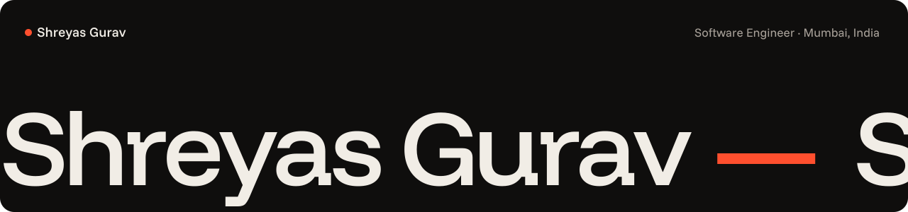
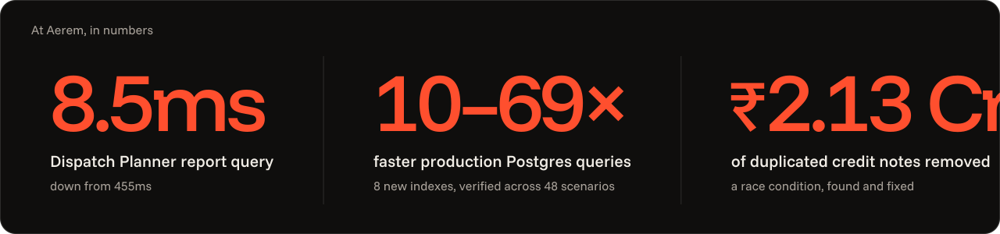

  

<em>
I build the boring layer under the impressive demo. 
Retrieval that returns the right chunk, endpoints that hold under load, pipelines that fail loudly instead of quietly — the parts nobody screenshots. 
Somewhere along the way I stopped trying to out-prompt the drift and started encoding the standard into the repo itself: a gate that fails the build, an import matrix that can't be violated, a spec that has to exist before the code does. That became <a href="https://github.com/Shreyas1015/create-rigel">rigel</a>. 
Now I do the same thing at work: put AI inside real financial infrastructure, then put guardrails around the AI. 
If I had one piece of advice: ship the measurement before you ship the model. Accuracy you can't reproduce is a rumour.
</em>

<b><a href="https://shreyas-full-stack-portfolio.vercel.app">shreyas-full-stack-portfolio.vercel.app →</a></b> · Mumbai, India

  

## Now

**Software Engineer @ [Aerem Solutions](https://www.aerem.co)** · Jul 2026 – present

India's solar-focused fintech group (Aerem, [NetZero Finance](https://www.aerem.co/about-us), the only RBI-licensed solar NBFC, and Sunstore Solar): ~350 MW of rooftop solar enabled across 12 states, 2,000+ verified installers, $15M pre-Series B led by SMBC Asia Rising Fund.

I own the internal tools ops, finance and sales run on every day: dispatch planning, payments and collections, the Zoho ERP sync, and the tracing that tells us when any of it breaks.

  

Also shipped:

- **Field Sales App, rebuilt solo** on Next.js 16 and React 19 with httpOnly BFF sessions; closed a login CSRF on the way.
- **Warranty self-service + OCR** (FastAPI, Google Cloud Vision, OpenCV) that verifies solar-panel serial numbers from photos.
- **Zoho ERP sync** for all 7 Purchases modules, with HMAC-verified webhooks and checkpointed, rate-limited backfills.
- **Microsoft Entra SSO** across 4 services, GST-verified checkout, a solar-kit builder, and a buy plan that prevented a 78,948-unit over-order.
- **`@aerem/telemetry`**, the internal npm SDK behind the company's first distributed tracing (OpenTelemetry, Grafana).

**Introduced the agent harness.** I brought agent-first development into the team: written repo rules, path-scoped constraints, specialist review agents, and a mechanical gate that has to pass before anything merges. It's built on [create-rigel](https://github.com/Shreyas1015/create-rigel), the same idea I open-sourced.

---

## Open source

Two npm packages, both MIT, both built for people who ship with AI coding agents.

<table>
  <tr>
    <td valign="top" width="50%">
      <a href="https://github.com/Shreyas1015/codeloom"><b>codeloom</b></a> · <a href="https://www.npmjs.com/package/codeloom">npm</a> 
      Feature maps for engineers and AI agents. Traces each page to the API route, code and database tables behind it, across separate frontend and backend repos, without using AI. Every link is marked exact or a guess, and CI blocks a release below 95% precision / 80% recall.  
      <code>npx codeloom init</code>  
      
    </td>
    <td valign="top" width="50%">
      <a href="https://github.com/Shreyas1015/create-rigel"><b>create-rigel</b></a> · <a href="https://www.npmjs.com/package/create-rigel">npm</a> 
      Scaffolds an agent-first, gate-enforced project (Next.js · Express+TS · NestJS · FastAPI), wired for Claude Code with a layered architecture, a strict import matrix, path-scoped rules, specialist review agents and a spec-driven workflow.  
      <code>npm create rigel@latest my-app</code>  
      
      
      
    </td>
  </tr>
</table>

The premise behind both: coding agents are good at writing code and bad at stopping themselves from drifting. The fix is a repo that constrains the agent. Rules it must follow, a fixed build order, and a gate (typecheck, zero-warning lint, circular-dep check, architecture tests, coverage thresholds) that fails the commit when the code is wrong. Quality enforced by checks, not by hoping someone remembers the standard.

Personal projects and experiments: <a href="https://github.com/Shreyas1015/Tripto-Client">Tripto</a> (B2B travel platform, <a href="https://tripto-web.vercel.app">live</a>), <a href="https://github.com/Shreyas1015/agentic-rag">agentic-rag</a>, <a href="https://github.com/Shreyas1015/starter-template">starter-template</a>, <a href="https://github.com/Shreyas1015/rigel-bookmarks-api">rigel-bookmarks-api</a> / <a href="https://github.com/Shreyas1015/rigel-bookmarks-web">rigel-bookmarks-web</a> (rigel dogfood builds), <a href="https://github.com/Shreyas1015/docker-setup-node">docker-setup-node</a>, <a href="https://github.com/Shreyas1015/ml-exps">ml-exps</a>, <a href="https://github.com/Shreyas1015/event-link-client">event-link</a>, <a href="https://github.com/Shreyas1015/apna-bharat-client">apna-bharat</a>

---

## Previously

**Software Engineer – Full Stack @ Schbang (Schbang Labs)** · Mumbai · Jun 2025 – Jul 2026

| Built | Outcome |
|---|---|
| **Second Brain**: end-to-end production RAG pipeline (FastAPI + vector DB), chunking, embedding and semantic search over 200+ brand assets | Client onboarding cut from 2–3 weeks to 2–3 days (**70%**) |
| **LLM resume screening**: parsing, scoring, output-quality metrics and regression checks, wired to an ElevenLabs voice-interview step | 500+ candidates/cycle at **92%** scoring accuracy; hiring cycle 21 days → 2–3 days |
| **Meet transcription orchestration**: event-driven AWS (SQS/SNS/Lambda) chaining Whisper ASR, Recall AI dedup, LLM summarisation | **95%** transcription accuracy; 2 hours → **<5 min**; ~₹1 Cr/yr saved vs. the commercial alternative |
| **Latency work**: Redis (ElastiCache), RDS read replicas, indexed query tuning on LLM-serving endpoints | 500–800 ms → **sub-200 ms**; avg DB query time **−60%** |
| **8-microservice AWS architecture**: EC2, RDS, S3, SQS, SNS, ElastiCache, CloudWatch | Independent deploy boundaries, structured logging + alerting |
| **Cost optimisation**: EC2 right-sizing, S3 lifecycle policies, ElastiCache tiering, validated against a 3-month billing baseline | **~20%** AWS spend reduction with latency SLOs preserved |

12 production features owned end-to-end (requirements, schema, API, evaluation, deployment) with **zero unplanned rollbacks** across a 9-month window.

---

## Stack

| Area | Tools |
|---|---|
| **Languages** | TypeScript, Python, JavaScript (ES6+), SQL |
| **Backend** | Node.js, AdonisJS, Express, NestJS, FastAPI, REST, HMAC webhooks, RabbitMQ, event-driven systems, microservices |
| **Frontend** | Next.js (App Router), React, TanStack Query, Zod, Tailwind, shadcn/ui |
| **Data** | PostgreSQL (indexing, EXPLAIN, pg_stat_statements), MongoDB, Redis (ElastiCache, Redlock), pgvector, Pinecone |
| **AI / ML** | LLM APIs, RAG, semantic search, MCP servers, evaluation & quality metrics, agent harnesses, Claude Code |
| **Cloud & observability** | AWS (EC2, RDS, S3, SQS, SNS, Lambda, ElastiCache, CloudWatch, SES), GCP Cloud SQL, Vercel, Docker, GitHub Actions, OpenTelemetry, Grafana, Prometheus, Loki, Tempo |
| **Integrations & testing** | Zoho Books/Inventory, Microsoft Entra (OAuth2/OIDC), Axis & ICICI bank APIs, IDfy, Google Cloud Vision · Vitest, Playwright, MSW |

---

## Credentials

**AWS Certified Developer – Associate** · Amazon Web Services · Feb 2026 – Feb 2029 · [verify on AWS ↗](https://cp.certmetrics.com/amazon/en/public/verify/credential/5e4985ab20b34a8e9c20337eeb4edd6d)
 Credential ID <code>5e4985ab20b34a8e9c20337eeb4edd6d</code>

**B.E. Computer Engineering** · Vasantdada Patil College of Engineering, Mumbai University · 2021 – 2025 · CGPA 7.75/10

---

  

Most production work lives in private org repos. Public activity reflects personal projects only.

---

  <a href="https://shreyas-full-stack-portfolio.vercel.app">Portfolio</a> ·
  <a href="https://linkedin.com/in/shreyasgurav1015">LinkedIn</a> ·
  <a href="https://github.com/Shreyas1015">GitHub</a> ·
  <a href="https://www.npmjs.com/package/codeloom">codeloom</a> ·
  <a href="https://www.npmjs.com/package/create-rigel">create-rigel</a> ·
  <a href="mailto:shreyasss15.10@gmail.com">Email</a>

